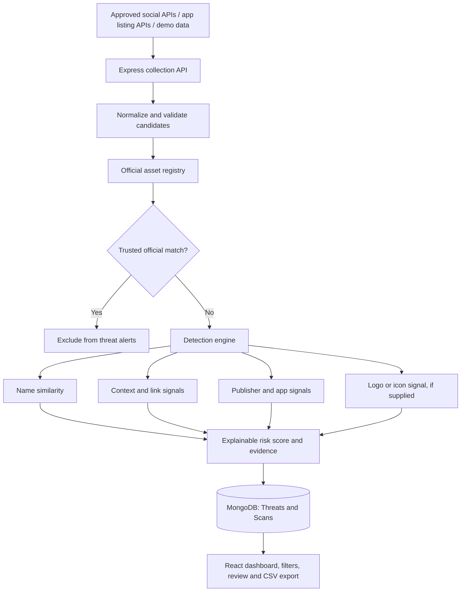

# BrandShield AI architecture

1. **Data sources**: approved social APIs, app-store listing APIs, permitted public datasets, or explicitly labeled demo/imported data.
2. **Collection API**: Express routes validate and normalize candidate records. Source metadata is retained.
3. **Official asset registry**: MongoDB `Brand` records hold official social URLs/account IDs and app package IDs/store URLs/publishers.
4. **Detection engine**:
   - normalize names and handle common Unicode look-alikes;
   - compute name similarity;
   - inspect available contextual signals such as descriptions, suspicious links, publisher mismatch, and icon/logo similarity supplied by an approved collector;
   - exclude candidates matching trusted official identifiers;
   - calculate a transparent, capped risk score with evidence.
5. **Storage**: MongoDB stores brands, threats, and scan runs.
6. **Dashboard**: React displays counts, scan actions, evidence, risk bands, and review statuses.

Official assets are checked against trusted identifiers before alerts are persisted. Name-only matches are not considered proof of legitimacy or maliciousness. Exact official account/app IDs should be preferred over display names.

